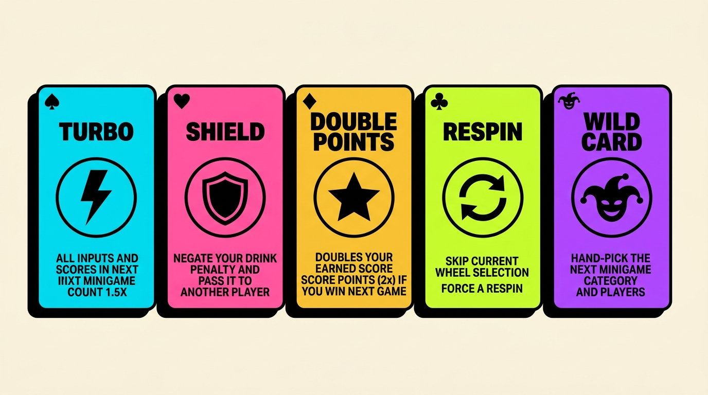

# 🃏 Final Specialty Cards System

This document details the 5 finalized Specialty Cards for the FizzBuzz party game. Players can draw, hold, and activate these cards during match setups and gameplay rounds to gain strategic advantages, double rewards, or pass drinking penalties to rivals!

---

## 📋 Final Specialty Cards Overview

| Card Name            | Rarity       | Activation Phase        | Special Ability Summary                                                   |
| :------------------- | :----------- | :---------------------- | :------------------------------------------------------------------------ |
| **1. Shield**        | 🛡️ Rare      | Resolution / Loss Phase | Negates a drinking penalty and passes it to a player of choice.           |
| **2. Turbo**         | ⚡ Rare      | Next Minigame Phase     | All inputs and scores count as 1.5x. In Math and Trivia, Turbo gives +1 point instead. |
| **3. Respin**        | 🔄 Common    | Wheel Selection Phase   | Skips the current minigame selection and forces a wheel respin.           |
| **4. Double Points** | 🌟 Epic      | Next Minigame Phase     | If you win the next game, your earned score points are doubled (2x).      |
| **5. Wild Card**     | 🃏 Legendary | Pre-Wheel / Match Setup | You choose the next minigame, the game mode, and the participating players. |

---

## 🎴 Detailed Card Breakdowns

### 1. 🛡️ Shield

- **Card Name**: Shield
- **Rarity**: Rare 🔵
- **Card Color**: Pink (card art color; the 🔵 tag above is the rarity)
- **Activation Phase**: _Resolution Phase (Upon Losing)_
- **Special Ability**:
  - Completely negates your drink penalty when you lose a minigame and allows you to redirect the drink assignment to any player of your choice in the lobby, including your own teammate in 2v2.
  - **Shield Chain**: If the targeted player holds a Shield, they can deflect the drinks to any player, including straight back to the player who passed them.
  - Each deflection adds +1 drink (1 → 2 → 3 → 4 …). There is no cap.
  - Each deflection uses up that player's Shield.
  - The first player who can't or doesn't deflect drinks the full accumulated total.

---

### 2. ⚡ Turbo

- **Card Name**: Turbo
- **Rarity**: Rare 🔵
- **Activation Phase**: _Before Starting Next Minigame_
- **Special Ability**:
  - Supercharges your performance for the next minigame: all score points, taps, and progress count at a **1.5x multiplier**. In Math and Trivia, Turbo gives +1 point instead of 1.5x.

---

### 3. 🔄 Respin

- **Card Name**: Respin
- **Rarity**: Common 🟢
- **Activation Phase**: _Wheel Selection Phase_
- **Special Ability**:
  - If you do not like the minigame category drawn on the wheel, you can activate this card to skip the selection and force an immediate wheel respin for the lobby.

---

### 4. 🌟 Double Points

- **Card Name**: Double Points
- **Rarity**: Epic 🟣
- **Activation Phase**: _Before Starting Next Minigame_
- **Special Ability**:
  - High-risk, high-reward power-up: if you win the next minigame, your earned leaderboard/game score points are **doubled (2x)**!

---

### 5. 🃏 Wild Card

- **Card Name**: Wild Card
- **Rarity**: Legendary 🟡
- **Activation Phase**: _Pre-Wheel / Match Setup Phase_
- **Special Ability**:
  - Ultimate lobby control: bypasses the wheel draw entirely, allowing you to hand-pick the exact minigame, choose the game mode, and manually select which players participate in the match!
